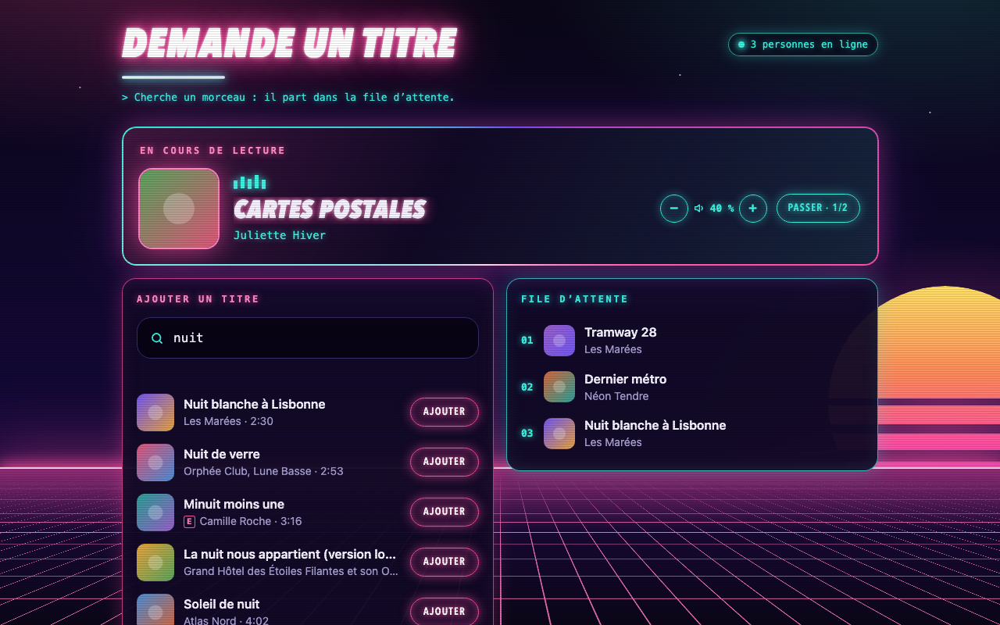

# Song request

Une page web où tes collègues cherchent un titre et l'ajoutent à **ta** file d'attente Spotify. Eux n'ont besoin d'aucun compte.



Il te faut un compte Spotify **Premium** : Spotify l'exige pour créer une app et pour ajouter des titres à la file d'attente.

## 1. Créer ton app Spotify

1. Ouvre le [Spotify Developer Dashboard](https://developer.spotify.com/dashboard) et clique sur **Create app**.
2. Nom et description : ce que tu veux, ils apparaîtront sur l'écran d'autorisation.
3. **Redirect URI** : mets exactement `http://127.0.0.1:3000/api/callback`.
4. Si le formulaire demande quelle API tu comptes utiliser, coche **Web API**. Accepte les conditions et enregistre.
5. Dans **Settings**, relève le **Client ID** et le **Client secret**.

## 2. Lancer la page

Deux façons de faire, à toi de choisir :

| | A. Sur ton ordinateur | B. Sur Vercel |
| --- | --- | --- |
| Mise en route | Une commande | Dix minutes de réglages |
| Qui peut ouvrir la page | Les appareils sur le même réseau que toi | Tout le monde, d'où qu'il soit |
| Disponible | Tant que le script tourne | En permanence |
| Votes et nombre de personnes en ligne | Exacts | Approximatifs |
| Il te faut | [Node.js](https://nodejs.org) 20.12 ou plus récent | Un compte GitHub et un compte [Vercel](https://vercel.com) gratuit |

### A. Sur ton ordinateur

1. Récupère ce repo : bouton **Code → Download ZIP**, ou `git clone`.
2. Dans le dossier, lance :

   ```sh
   npm start
   ```

3. Réponds aux trois questions : Client ID, Client secret, et le code d'accès que tu donneras à tes collègues.
4. Ton navigateur s'ouvre sur Spotify : accepte l'autorisation.

Le terminal affiche alors le lien à partager :

```
Song request est prêt.
  Sur cet ordinateur : http://127.0.0.1:3000/?code=4821
  Pour tes collègues : http://192.168.1.23:3000/?code=4821   (même réseau que toi)
```

Les fois suivantes, `npm start` suffit : tes réponses sont enregistrées dans le fichier `.env`.

À savoir :

- Laisse la fenêtre du terminal ouverte. `Ctrl+C` arrête la page.
- Au premier lancement, macOS ou Windows peut demander d'autoriser les connexions entrantes. Accepte, sinon tes collègues ne pourront pas ouvrir la page.
- Si ton ordinateur change de réseau, l'adresse à partager change. Elle est réaffichée à chaque lancement.

### B. Sur Vercel

**B1. Déployer**

[](https://vercel.com/new/clone?repository-url=https%3A%2F%2Fgithub.com%2FArthurBlr%2Fspotify-song-request&env=SPOTIFY_CLIENT_ID,SPOTIFY_CLIENT_SECRET,ACCESS_CODE&envDescription=Identifiants%20de%20ton%20app%20Spotify%20et%20code%20d%27acc%C3%A8s%20%C3%A0%20donner%20%C3%A0%20tes%20coll%C3%A8gues&envLink=https%3A%2F%2Fgithub.com%2FArthurBlr%2Fspotify-song-request%23b-sur-vercel&project-name=song-request&repository-name=song-request)

Le bouton copie ce repo sur ton GitHub, puis te demande trois valeurs :

| Variable | Valeur |
| --- | --- |
| `SPOTIFY_CLIENT_ID` | Le Client ID de l'étape 1 |
| `SPOTIFY_CLIENT_SECRET` | Le Client secret de l'étape 1 |
| `ACCESS_CODE` | Un code de ton choix, à donner aux personnes autorisées à demander des titres |

Une fois le déploiement terminé, relève l'adresse de ton site, par exemple `https://song-request-abc.vercel.app`. Prends l'adresse principale du projet (rubrique **Domains**), pas celle d'un déploiement particulier.

> Tu préfères sans le bouton ? Clique sur **Use this template** en haut de ce repo, puis importe ta copie dans Vercel avec **Add New → Project** et renseigne les mêmes variables.

**B2. Déclarer ton adresse chez Spotify**

Dans ton app Spotify, **Settings → Redirect URIs**, ajoute :

```
https://TON-SITE.vercel.app/api/callback
```

L'adresse doit être exactement celle-ci, sans `/` à la fin. En cas de doute, ouvre ton site : la page d'accueil affiche l'adresse à copier.

**B3. Relier ton compte Spotify**

1. Ouvre `https://TON-SITE.vercel.app/api/login` et accepte l'autorisation.
2. La page affiche un *refresh token*. Copie-le.
3. Dans Vercel, **Settings → Environment Variables**, ajoute `SPOTIFY_REFRESH_TOKEN` avec cette valeur.
4. Dans **Deployments**, ouvre le menu du dernier déploiement et choisis **Redeploy**. Sans ça, la nouvelle variable n'est pas prise en compte.

Le lien à partager est `https://TON-SITE.vercel.app/?code=TON_CODE`.

## Utilisation

- Lance de la musique sur Spotify, sur n'importe quel appareil. Spotify n'accepte les ajouts que pendant une lecture.
- Partage le lien avec le code. Le navigateur de chacun le retient après la première visite. Tu peux aussi donner l'adresse et le code séparément.
- Dans la recherche, on peut taper un titre, un artiste, ou coller un lien Spotify.
- La file d'attente a son propre volet : à côté de la recherche sur un écran large, dans un onglet sur téléphone.
- Le bouton **Passer** sert à voter pour passer le titre en cours. Il est passé dès que plus de la moitié des personnes en ligne ont voté : 2 votes pour 3 personnes, 3 pour 4. Quand on est seul sur la page, un vote suffit.
- Les boutons **−** et **+** règlent le volume de Spotify par pas de 10 %. Depuis la page, il ne monte jamais au-dessus de 50 % et ne descend jamais sous 10 %. Toi, tu restes libre de le régler comme tu veux dans Spotify : si tu dépasses 50 %, la page permet seulement de le baisser.
- Le nombre de personnes en ligne s'affiche en haut de la page. Il compte les navigateurs où la page est ouverte et visible.

Trois règles évitent les abus :

- Un titre en cours de lecture ou déjà dans la file est refusé.
- Chaque navigateur attend 3 secondes entre deux demandes.
- Chaque navigateur attend 10 secondes entre deux réglages du volume.

## À refaire tous les six mois

Spotify désactive l'autorisation six mois après que tu l'as donnée. La page affiche alors « La connexion au compte Spotify a expiré ».

- **Sur ton ordinateur** : ouvre `http://127.0.0.1:3000/api/login` et accepte de nouveau. C'est tout.
- **Sur Vercel** : refais l'étape B3 en remplaçant la valeur de `SPOTIFY_REFRESH_TOKEN`.

La page affichée après l'autorisation t'indique la date d'expiration : mets-toi un rappel.

## Réglages

Sur ton ordinateur, ils se trouvent dans le fichier `.env` ; relance `npm start` après un changement. Sur Vercel, dans **Settings → Environment Variables** ; redéploie après un changement.

| Variable | Rôle | Par défaut |
| --- | --- | --- |
| `SPOTIFY_CLIENT_ID` | Identifiant de ton app Spotify | obligatoire |
| `SPOTIFY_CLIENT_SECRET` | Secret de ton app Spotify | obligatoire |
| `SPOTIFY_REFRESH_TOKEN` | Autorisation de ton compte, obtenue à la connexion | obligatoire |
| `ACCESS_CODE` | Code demandé aux visiteurs. Vide : la page est ouverte à tous | vide |
| `COOLDOWN_SECONDS` | Délai entre deux demandes d'un même navigateur. `0` : aucun délai | `3` |
| `VOLUME_MAX` | Volume le plus fort que les visiteurs peuvent régler, en %. `0` : pas de réglage du volume depuis la page | `50` |
| `VOLUME_MIN` | Volume le plus faible que les visiteurs peuvent régler, en % | `10` |
| `PORT` | Sur ton ordinateur seulement : port de la page. Si tu le changes, change aussi la Redirect URI de l'étape 1 | `3000` |
| `HOST` | Sur ton ordinateur seulement : `127.0.0.1` rend la page invisible pour les autres appareils | `0.0.0.0` |

## Dépannage

| Symptôme | Cause et solution |
| --- | --- |
| Spotify affiche « INVALID_CLIENT: Invalid redirect URI » | La Redirect URI déclarée dans ton app Spotify ne correspond pas exactement à l'adresse utilisée. Vérifie `http` ou `https`, le domaine, le port et l'absence de `/` final. |
| « Rien n'est en lecture sur Spotify » | Lance un titre. La file n'existe que pendant une lecture. |
| « Spotify refuse la demande » | Dans ton app Spotify, **Settings → User Management**, ajoute ton propre compte (nom et e-mail Spotify). |
| « Le compte Spotify relié doit être Premium » | L'abonnement Premium est obligatoire. |
| Les boutons de volume n'apparaissent pas | L'appareil qui joue la musique ne permet pas de régler son volume à distance : c'est souvent le cas des téléphones. Lance la lecture sur un ordinateur ou une enceinte connectée. Ils sont aussi absents quand rien n'est en lecture, ou si `VOLUME_MAX` vaut `0`. |
| Le volume baisse sur la page mais le son reste fort | La page règle le volume de Spotify, pas celui de l'ordinateur ou de l'enceinte. Baisse aussi celui-ci. |
| « La connexion au compte Spotify a expiré » | Voir « À refaire tous les six mois ». |
| Tes collègues n'arrivent pas à ouvrir le lien (script sur ton ordinateur) | Ils doivent être sur le même réseau que toi, et ton pare-feu doit autoriser Node.js. Certains Wi-Fi invités empêchent les appareils de se voir : dans ce cas, passe par Vercel. |
| « Le port 3000 est déjà pris » | Un autre programme l'utilise. Ferme-le, ou change `PORT`. |
| Sur Vercel, la page affiche toujours « Installation à terminer » | Une variable manque, ou tu n'as pas redéployé après l'avoir ajoutée. Les erreurs détaillées sont dans l'onglet **Logs**. |

## Comment c'est fait

| Élément | Contenu |
| --- | --- |
| `public/` | La page : HTML, CSS et JavaScript sans framework |
| `api/` | Une fonction par route : `login`, `callback`, `search`, `queue`, `request` |
| `lib/` | Appels à Spotify, contrôle du code d'accès et des limites |
| `local-server.js` | Le script lancé par `npm start` |
| `test/` | Tests, lancés par `npm test`. Ils simulent Spotify et ne demandent ni compte ni réseau |

- Aucune dépendance à installer.
- Le Client secret et le refresh token restent côté serveur. Le navigateur des visiteurs ne les voit jamais.
- L'autorisation demandée à Spotify se limite à lire la lecture en cours, ajouter des titres à la file, passer au titre suivant et régler le volume.
- Sur ton ordinateur, seul cet ordinateur peut relier ou changer le compte Spotify : `/api/login` est refusé aux autres appareils.
- Les limites sont volontairement simples : chaque délai tient dans un cookie signé, et un plafond par adresse IP s'applique par 10 minutes : 30 demandes, 60 réglages du volume. Un autre cookie signé distingue les navigateurs, pour compter les personnes en ligne et donner un vote à chacune. Ces limites découragent les abus entre collègues, pas une attaque déterminée. Garde un `ACCESS_CODE`.
- Les votes et le nombre de personnes en ligne sont gardés dans la mémoire du serveur : ils repartent de zéro quand tu relances le script. Sur Vercel, les visiteurs peuvent être répartis sur plusieurs instances qui ne partagent pas leur mémoire : le compteur peut alors être sous-estimé, et un titre passé avec moins de votes.
